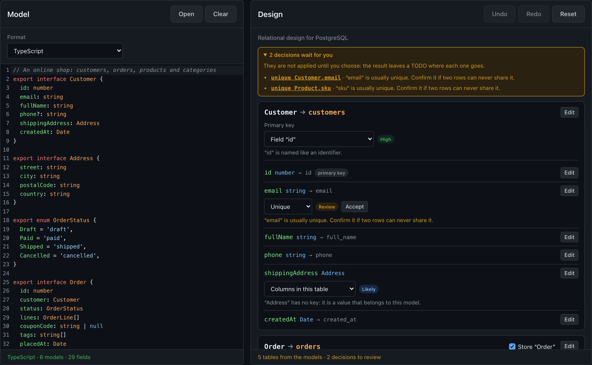

# Model2DB

Client-side tool that turns a data model (classes, DTOs, JSON, schemas) into a database design you review decision by decision, and writes the schema, the ORM models and the migrations for it, **without sending anything to a server**.

- 🇬🇧 **English:** [Full documentation](./README_en.md)
- 🇪🇸 **Español:** [Documentación completa](./README_es.md)

  

## What is this repository?

Model2DB helps go from the models of an application to its database: paste or open the models in any of 23 formats (TypeScript with or without Zod, Python, Java, C#, Kotlin, Dart, Swift, Go, Rust, PHP, Scala, JavaScript, JSON, YAML, XML, CSV, JSON Schema, OpenAPI, GraphQL, Protocol Buffers, Smithy, Prisma or a model schema), review the tables, keys, relations, embedded documents and indexes it proposes with their confidence, and copy or download the result for one of 26 outputs:

- SQL for PostgreSQL, MySQL, MariaDB, SQLite, SQL Server or Oracle, or a MongoDB script with validators.
- ORM and ODM models, with migrations where the tool has them: Django, SQLAlchemy, SQLModel, Tortoise, PyMongo, MongoEngine, Beanie, Prisma, TypeORM, Sequelize, Drizzle, Mongoose, JPA, Hibernate, Spring Data JPA, Spring Data MongoDB, Entity Framework Core, Laravel Eloquent and Doctrine.

It proposes, but never decides an ambiguity: decisions to review wait for the user, and the result leaves a `TODO` where each one goes.

There are two versions, checked by shared test cases:

- **Web**: React + TypeScript, in the browser. Not published yet.
- **[Desktop](./desktop/README_en.md)**: Python + PySide6. The same features and exactly the same files, on your computer.

It is the last tool of the chain [Api2Class](https://github.com/RaulEstevezA/Api2Class) → [Mapper](https://github.com/RaulEstevezA/Mapper) → Model2DB, and works on its own as well.

## Suggestions

Ideas for improvements, bugs or a database you would like Model2DB to write for: write to [contact.raulesteveza@gmail.com](mailto:contact.raulesteveza@gmail.com).

## Developer

**Raul Estevez**

- [Personal Website](https://raulesteveza.github.io/)
- [LinkedIn Profile](https://www.linkedin.com/in/raulesteveza/)

## License

[MIT](./LICENSE)
