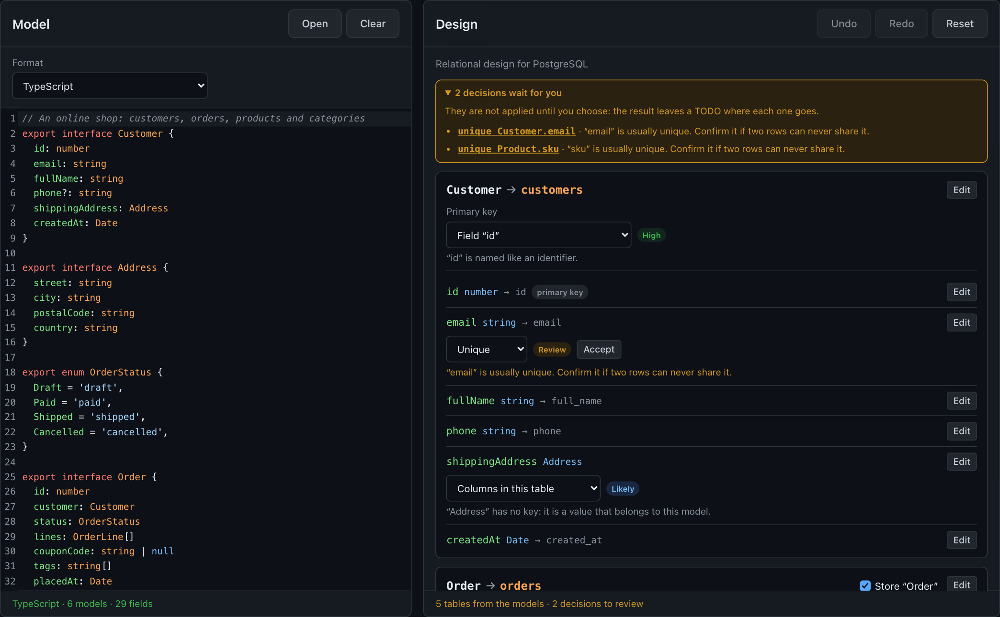

# Model2DB

Client-side tool that turns a data model (classes, DTOs, JSON, schemas) into a database design you review decision by decision, and writes the schema, the ORM models and the migrations for it, **without sending anything to a server**.

**Try it online:** [raulesteveza.github.io/tools/Model2DB](https://raulesteveza.github.io/tools/Model2DB/)

- 🇬🇧 **English:** [Full documentation](./README_en.md)
- 🇪🇸 **Español:** [Documentación completa](./README_es.md)

  

## What is this repository?

Model2DB helps go from the models of an application to its database: paste or open the models in any of 23 formats (TypeScript with or without Zod, Python, Java, C#, Kotlin, Dart, Swift, Go, Rust, PHP, Scala, JavaScript, JSON, YAML, XML, CSV, JSON Schema, OpenAPI, GraphQL, Protocol Buffers, Smithy, Prisma or a model schema), review the design it proposes for a relational, document, key-value or wide-column database, with the confidence of every decision, and copy or download the result for one of 32 outputs:

- SQL for PostgreSQL, MySQL, MariaDB, SQLite, SQL Server or Oracle, also as a Flyway or Liquibase migration.
- MongoDB, Couchbase, Redis, Cassandra or ScyllaDB: collections and validators, keys and search indexes, or CQL tables and types.
- ORM and ODM models, with migrations where the tool has them: Django, SQLAlchemy, SQLModel, Tortoise, PyMongo, MongoEngine, Beanie, Prisma, TypeORM, Sequelize, Drizzle, Mongoose, JPA, Hibernate, Spring Data JPA, Spring Data MongoDB, Entity Framework Core, Laravel Eloquent and Doctrine.

It proposes, but never decides an ambiguity: decisions to review wait for the user, and the result leaves a `TODO` where each one goes.

There are two versions, checked by shared test cases:

- **[Web](https://raulesteveza.github.io/tools/Model2DB/)**: React + TypeScript, in the browser.
- **[Desktop](./desktop/README_en.md)**: Python + PySide6. Installable app for Windows, macOS and Linux, with the same features and exactly the same files.

It is the last tool of the chain [Api2Class](https://github.com/RaulEstevezA/Api2Class) → [Mapper](https://github.com/RaulEstevezA/Mapper) → Model2DB, and works on its own as well.

## Suggestions

Ideas for improvements, bugs or a database you would like Model2DB to write for: write to [contact.raulesteveza@gmail.com](mailto:contact.raulesteveza@gmail.com).

## Developer

**Raul Estevez**

- [Personal Website](https://raulesteveza.github.io/)
- [LinkedIn Profile](https://www.linkedin.com/in/raulesteveza/)

## License

[MIT](./LICENSE)
